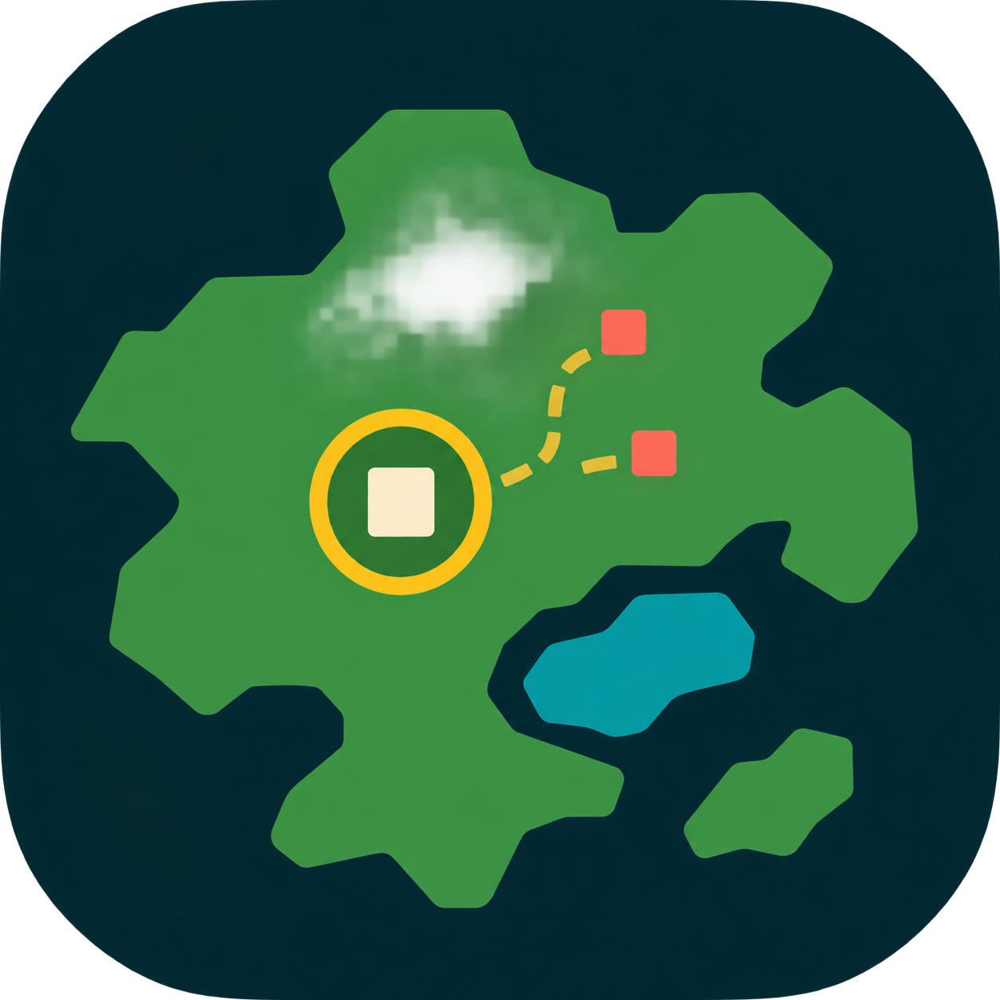

# DotARPG



小さな点たちが勝手に冒険する、眺めるためのアクションRPG。

A spectator action RPG: tiny dots explore, fight, dodge, grow stronger, and sometimes die, all on their own.

## 遊ぶ / Play

Windows x64向け。Releasesの `DotARPG.exe` ひとつで動きます。.NETランタイムの別途インストールは不要です。

Download `DotARPG.exe` from Releases and run it on Windows x64. The .NET runtime is included.

- 和風・洋風・中華風・オリエンタルな世界と物語を自動生成。
- 同じ地図の上で移動・戦闘・回避。ボス戦ではその場所へズーム。
- プレイヤーごとの行動、装備の収集、未踏地の探索、拠点からの復活。
- 途中保存、プレイデータ、同じ作品への別プレイヤーの挑戦、時々現れる続編。
- 右上のボタンで日本語／Englishを切り替え。
- プレイデータ画面で、4人のプレイヤーの肖像と冒険の記録を確認。
- 和風・洋風・中華風・オリエンタルのマップBGMを収録。右上の♫で音量・ミュートを変更。曲末のフェードを含めてループします。
- 中ボス・ラスボス戦では共通のボスBGMへ切り替わり、探索に戻るとマップBGMへ戻ります。

| 場面 / Scene | BGM |
|---|---|
| 和風 / Japanese | Stillness at the Mountain Gate |
| 洋風 / Western | Sunlight on Worn Stone |
| 中華風 / Chinese | 远山凝露 |
| オリエンタル / Oriental | Silver Sands Passage |
| 中ボス・ラスボス / Boss battles | Waiting for the Opening |

| 操作 / Key | 動作 / Action |
|---|---|
| Space | 一時停止・再開 / Pause or resume |
| N | 次の世界 / Next world |
| F11 | 全画面 / Full screen |
| Enter | OPから観戦へ / Start watching |
| × / Exit | 保存して終了 / Save and exit |

保存先 / Save location: `%LOCALAPPDATA%\DotARPG`

## 開発 / Build

Windowsと.NET 10 SDKが必要です。

```powershell
dotnet build DotARPG.csproj -c Release
dotnet publish DotARPG.csproj -p:PublishProfile=SelfContained
```

単一EXEの出力先 / Single EXE output: `artifacts/win-x64/DotARPG.exe`

```powershell
dotnet run --project Tests/DotARPG.Checks.csproj -c Release -- --town-smoke
dotnet run --project Tests/DotARPG.Checks.csproj -c Release -- --language-smoke
```

GitHub Actions builds and checks `main` and pull requests. Pushing an annotated `v*` tag publishes the single EXE and its SHA-256 checksum to GitHub Releases. Release notes come from the tag message.

## License

[MIT](LICENSE)
